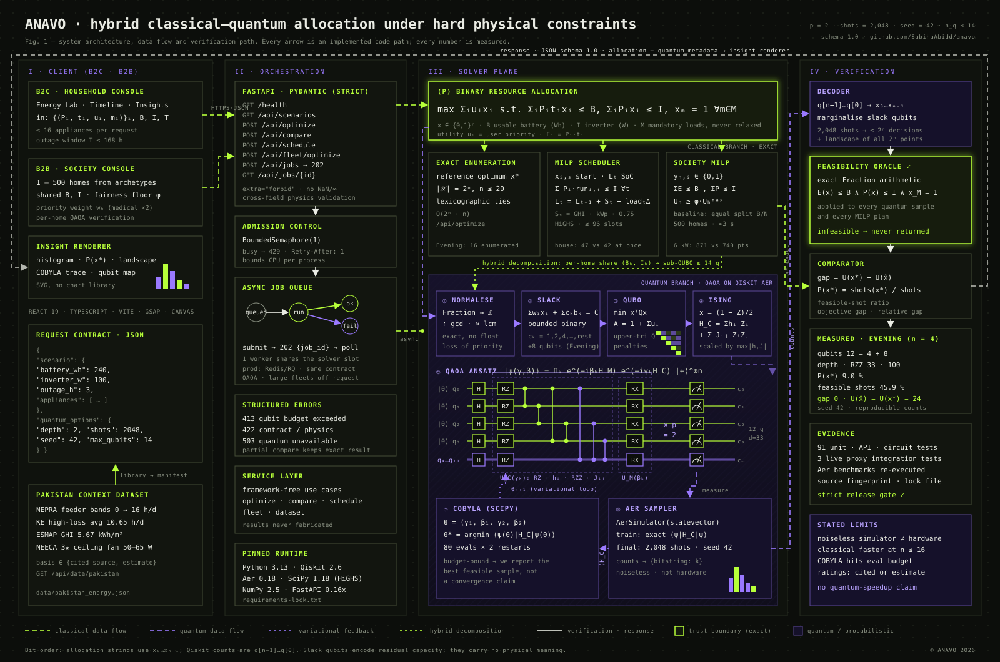

# ANAVO

**When power is limited, intelligence shouldn't be.**

Quantum-Assisted Energy Resilience Optimization for Pakistan | Energy & Smart Infrastructure

ANAVO helps a household choose which appliances to run during a power outage. It maximizes user-stated utility under usable battery-energy and simultaneous inverter-power limits, with explicit mandatory-load requirements. **Final architecture: React + TypeScript + Vite -> FastAPI/Python -> Qiskit or the classical solver.** The separate React frontend in frontend/ implements the supplied pixel/cyberpunk design reference. Streamlit is optional archived demo code only and is not installed or tested by the backend release workflow.

## Quick start: build and run ANAVO

### Prerequisites
- **Python 3.13** (tested with 3.13.5)
- **Node.js 20+** and npm
- Git

### 1. Get the code
```bash
git clone https://github.com/SabihaAbidd/anavo.git
cd anavo
```

### 2. Backend (FastAPI + Qiskit)
Windows PowerShell:
```powershell
python -m venv .venv
.\.venv\Scripts\python.exe -m pip install --upgrade pip
.\.venv\Scripts\python.exe -m pip install -r requirements-lock.txt
.\.venv\Scripts\python.exe -m uvicorn backend.main:app --host 127.0.0.1 --port 8000
```
macOS / Linux:
```bash
python3 -m venv .venv
.venv/bin/python -m pip install --upgrade pip
.venv/bin/python -m pip install -r requirements-lock.txt
.venv/bin/python -m uvicorn backend.main:app --host 127.0.0.1 --port 8000
```
`requirements-lock.txt` pins the exact tested versions; `requirements.txt` gives compatible ranges. Streamlit is **not** needed.

Check it: http://127.0.0.1:8000/health and the interactive API docs at http://127.0.0.1:8000/docs.

### 3. Frontend (React + Vite), in a second terminal
```bash
cd frontend
npm ci
npm run dev
```
Open **http://127.0.0.1:5173/**. Vite proxies `/api` and `/health` to the backend on port 8000, so start the backend first.

### 4. Production build of the frontend
```bash
cd frontend
npm run build      # type-checks with tsc, outputs frontend/dist
npm run preview    # serves the built site locally
```

### 5. Run the checks
From the project root (Windows paths shown; use `.venv/bin/python` on macOS/Linux):
```powershell
.\.venv\Scripts\python.exe -m scripts.validate                     # 91 backend, solver and quantum tests
.\.venv\Scripts\python.exe -m scripts.benchmark --require-quantum  # real QAOA benchmarks on Aer
.\.venv\Scripts\python.exe -m scripts.api_startup_check            # real HTTP checks on a temporary server
.\.venv\Scripts\python.exe -m scripts.verify_release               # strict release gate
```
With both servers running, from `frontend/`:
```bash
npm run test:integration   # 3 live proxy tests, including a quantum job
```

### Using the app
1. **Energy Lab:** pick a preset (Evening backup, Ample, Limited, Mandatory infeasible) or edit appliances, then **Optimize**. Switch to **Classical + Quantum** to run QAOA and see the **Quantum Insights** panel (about 20 s).
2. **Timeline:** **Load Pakistani house example**, choose a start time and optional rooftop solar, then **Plan hour by hour**.
3. **Society grid (B2B):** set home counts, shared battery/inverter, outage profile and fairness floor, then **Optimize society**. Click a home and **Verify with QAOA**.
4. **Pakistan data:** browse cited outage and solar figures; **+** adds an appliance to your Energy Lab manifest.

### Troubleshooting
| Symptom | Fix |
|---|---|
| "BACKEND OFFLINE" in the app | Start uvicorn on port 8000, then reload the page |
| `Another optimization is running` (HTTP 429) | Wait for the current QAOA job to finish and retry |
| Quantum result says **oversized** | The problem needs more than 14 qubits; use fewer appliances or simpler capacities |
| Port 5173 or 8000 already in use | Stop the other process or change the port (the frontend proxy expects 8000) |

A recording-ready walkthrough is in [docs/VIDEO_SCRIPT.md](docs/VIDEO_SCRIPT.md).

## Features (B2C households + B2B housing societies)

| Feature | What it does | Engine | Endpoint |
|---|---|---|---|
| Household optimizer | Picks which appliances to power within battery (Wh) and inverter (W) limits; mandatory loads never dropped | Exact enumeration | `POST /api/optimize` |
| Classical vs quantum | Same problem as a QUBO with slack qubits, solved by QAOA on Qiskit Aer and checked against the exact optimum | QUBO -> Ising -> QAOA + COBYLA | `POST /api/compare` |
| Quantum insights | Measured histogram, probability of the exact optimum, COBYLA convergence trace, qubit map, gate counts, full solution landscape | Real Aer measurements | part of `/api/compare` |
| Hour-by-hour planner | Decides *when* each appliance runs; per-slot inverter limit, battery state of charge, optional rooftop solar | Exact MILP (SciPy HiGHS) | `POST /api/schedule` |
| Society grid (B2B) | One shared battery/inverter for up to 500 homes; mandatory loads per home, fairness floor, comparison vs equal split; single-home QAOA verification | Exact MILP + hybrid decomposition | `POST /api/fleet/optimize` |
| Async job queue | Slow QAOA runs and large fleets run off the request path; poll by job id | In-process worker sharing the solver slot | `POST/GET /api/jobs` |
| Pakistan dataset | NEPRA load-shedding bands, ESMAP solar resource, NEECA fan ratings and an appliance library, each tagged with its source or marked as an estimate | `data/pakistan_energy.json` | `GET /api/data/pakistan` |

Example results (all reproducible with the tests): a typical Pakistani house scores 47 with scheduling vs 42 when every load is reserved at once; a 24-home society at 40 kWh / 6 kW serves 871 priority points vs 740 for an equal split and keeps every home's oxygen concentrator running (equal split leaves 2 homes without it); 500 homes (3,076 decisions) solve in about 3 s.

## Backend-first architecture update

The primary application is a FastAPI/Pydantic backend that reuses the existing independent optimization engine. React + TypeScript + Vite now lives in frontend/, with GSAP animation, a procedural pixel planet, neon lime/purple styling and live optimization controls. The Streamlit app is preserved without feature development. Public **[SabihaAbidd/anavo](https://github.com/SabihaAbidd/anavo)** is connected as origin/main. On 2026-11-12, `git ls-remote origin main` returned `3940efd61cdc3eaa7cba19abafe923709ff7a9b1`, matching local HEAD, so the React frontend, recorded-style opening and logo fix are published. See TASKS.md for the latest verified commit and the current check results.

Backend implementation and executed validation are tracked in TASKS.md and results/. Use the project .venv interpreter, which now has the verified API and quantum dependencies.

## Current verified status

The installed project .venv has passed **91 required backend tests (72 original + 19 for scheduling, fleets, jobs, dataset and quantum insights) with zero skips, failures or errors**, including actual FastAPI requests and Qiskit Aer circuits. An actual Uvicorn server passed **12 real HTTP checks**, covering all five routes, measured quantum optimize/compare requests, constraints, validation and CORS. Streamlit is absent and pip check found no broken requirements. requirements-lock.txt pins the 27 tested backend packages.

Actual QAOA benchmarks used p=2, 2,048 shots and seed 42. The best feasible samples matched exact utilities 30 and 15 with zero best-sample gaps; the mandatory-infeasible case produced no feasible sample. Repeated executions with identical source fingerprints reproduced counts and optimized parameters. The strict local release gate passed. See results/validation.json, api_startup_check.json, benchmark_results.json, benchmark_reproducibility.json and release_check.json.

These are ideal simulator results, not quantum speedup or hardware evidence. COBYLA reached its evaluation budgets, and the limited scenario had only about 24.3% physically feasible shots. Publication and CI status are separate from local readiness; The React frontend is now implemented separately; see frontend/README.md.

## Start the FastAPI backend

From this project folder in Windows PowerShell:

```powershell
python -m venv .venv
.\.venv\Scripts\python.exe -m pip install -r requirements.txt
.\.venv\Scripts\python.exe -m uvicorn backend.main:app --host 127.0.0.1 --port 8000
```

Health: http://127.0.0.1:8000/health · Swagger UI: http://127.0.0.1:8000/docs · ReDoc: http://127.0.0.1:8000/redoc · OpenAPI: http://127.0.0.1:8000/openapi.json

| Method / route | Behavior |
|---|---|
| `GET /health` | Service liveness and quantum dependency presence; does not claim circuit validation |
| `GET /api/scenarios` | Four validated editable example scenarios |
| `POST /api/optimize` | Explicit classical or quantum selection; structured allocation or error |
| `POST /api/compare` | Same scenario, both solvers; clearly labeled partial result if quantum unavailable |
| `GET /api/algorithm-info` | Objective, units, assumptions, algorithm and compute limits |

Full request/response contracts and error semantics are in [docs/API.md](docs/API.md). The API limits inputs to 16 appliances and quantum encodings to 14 qubits; the underlying engine's existing 20-appliance classical limit is unchanged. One heavy request per process is admitted at a time; busy requests get 429. Restrict local CORS with `ANAVO_CORS_ORIGINS` (default `http://localhost:5173,http://127.0.0.1:5173`). This is an unauthenticated local research API, not a public hosted service.

Example classical request using a shipped JSON fixture:

```powershell
Invoke-RestMethod -Method Post -Uri http://127.0.0.1:8000/api/optimize -ContentType application/json -Body (Get-Content -Raw docs/examples/optimize-request.json)
```

## Optional legacy prototype (not the application frontend)

Python 3.13 is available in the development environment; use Python 3.11–3.13 with compatible package wheels.

```powershell
python -m venv .venv
.\.venv\Scripts\python.exe -m pip install -r requirements-demo.txt
.\.venv\Scripts\python.exe -m streamlit run app.py
```

These commands are optional. The original app.py and .streamlit/config.toml are preserved, with historical tests and the old startup probe in legacy_demo/. Backend setup, CI and strict release checks use requirements.txt and tests/ only. See [legacy_demo/README.md](legacy_demo/README.md) for opt-in historical test commands. Installing the optional file includes the backend requirements plus Streamlit; installing the backend file alone never requests Streamlit.

## Reproduce and verify

```powershell
.\.venv\Scripts\python.exe -m unittest discover -s tests -v
.\.venv\Scripts\python.exe -m scripts.validate
.\.venv\Scripts\python.exe -m scripts.api_startup_check
.\.venv\Scripts\python.exe -m scripts.benchmark --require-quantum
.\.venv\Scripts\python.exe -m scripts.verify_release
```

Tests use the standard library unittest runner. FastAPI HTTP tests are skipped when FastAPI is absent; circuit/quantum API tests are skipped when dependencies are absent. Green tests with skips establish neither HTTP nor quantum validity. `scripts.validate` saves actual outcomes with separate completeness flags. `verify_release` rejects skips, failed API health probes, unavailable quantum benchmarks, and absent measured comparisons. Requirements declare compatibility ranges; benchmark/validation records list actual installed versions. requirements-lock.txt pins the now-tested backend environment.

The HTTP script now exercises all five routes, actual small QAOA optimize/compare requests, infeasibility, invalid input, zero capacity, quantum limits and CORS. A health-only response is insufficient. The gate checks runtime source fingerprints, benchmark scenario coverage, positive shot counts, measured best selections, exact classical allocations, probabilities and gaps. Source fingerprints detect stale records, not cryptographic proof of quantum execution. Synthetic consistency fixtures exist only in tests and are never published as measured benchmarks.

`.github/workflows/backend-ci.yml` installs real dependencies on a hosted Python 3.13 runner, performs HTTP and quantum experiments, runs the strict gate, and retains result artifacts. Its repository token is read-only; it neither pushes source nor changes permissions. The CI workflow itself has been syntax checked locally; a passing CI run requires publication and actual execution.

To publish this continuation without waiting for dependency installation, run `.\scripts\publish_now.ps1` from ordinary Windows PowerShell. Then inspect https://github.com/SabihaAbidd/anavo/actions. The user's initial publish works outside this managed agent session; current agent staging and GitHub Git-tree writes remain denied. If a CI job fails, its logs/artifacts—not the existence of the workflow—determine the next defect or blocker.

For a Windows terminal with ordinary network and Git write access, run `.\scripts\finish_setup.ps1`. It first invokes the verified GitHub setup workflow, preserving implemented work and its honest blocked-status documentation in a commit, then installs dependencies, runs actual API/quantum validation and benchmarks, and publishes the next milestone. GitHub CLI must be installed and authenticated. It creates only **public `anavo`**, refuses unrelated remotes/history/private repositories, and verifies GitHub and remote commit hashes. See [docs/GITHUB_SETUP.md](docs/GITHUB_SETUP.md). No passwords or tokens are requested in chat.

## Backend demonstration

1. Start Uvicorn using the backend command above and open http://127.0.0.1:8000/docs.
2. Call health, scenarios and algorithm-info; inspect their actual JSON responses.
3. Submit docs/examples/optimize-request.json to POST /api/optimize. The evening exact recommendation is fan, lights and router: 180 Wh, 60 W, utility 24.
4. Submit docs/examples/compare-request.json to POST /api/compare. Quantum measurements appear only when real Qiskit execution succeeds; unavailable results stay explicit.
5. Try the mandatory-infeasible preset and negative values to demonstrate hard constraints and validation. No React UI has been built yet.

## Architecture



*Fig. 1 — hybrid classical–quantum architecture: client (B2C/B2B) → FastAPI orchestration and job queue → exact classical branch and QUBO → Ising → QAOA branch with COBYLA feedback → exact feasibility oracle and comparator. Numbers are measured on the Evening scenario.*

`backend/main.py` -> strict Pydantic request -> `backend/service.py` -> existing `src/` engine -> physical feasibility check -> typed JSON response. The legacy `app.py` continues to call the same engine independently. No FastAPI imports were introduced into optimization code.

| Path | Purpose |
|---|---|
| `PLAN.md`, `TASKS.md` | Decisions, milestones, validation evidence and blockers |
| `backend/` | FastAPI routes, strict contracts, independent service adapter, restricted CORS settings |
| `requirements-demo.txt`, `legacy_demo/` | Optional Streamlit dependency and preserved historical checks; excluded from backend release |
| `src/classical_solver.py` | Exact baseline with deterministic tie handling |
| `src/optimization.py` | Exact decimal normalization, bounded slack QUBO, Ising mapping |
| `src/quantum_solver.py` | H/RZ/RZZ/RX circuit, COBYLA, statevector expectation, measured counts |
| `src/evaluation.py` | Identical-input comparison, versions, explicit unavailable state |
| `results/benchmark_results.json` | Actual executed benchmarks; inspect completeness flag |
| `results/validation.json` | Actual test pass/fail/skip evidence, API and quantum completeness flags |
| `docs/` | Derivation, research, architecture, report, pitch, demo, submission checklist |

## Limitations and future work

This is decision support, not an electrical controller. Appliance power ratings are published figures or typed estimates (see data/pakistan_energy.json), not measurements collected by the team. Battery input is usable AC-side energy. In /api/optimize and /api/compare selected appliances run for fixed durations and power is conservatively reserved simultaneously; /api/schedule removes that simplification with exact time slots. Essential is an explanatory label; utility expresses priority; mandatory is a hard constraint. Solar uses an average daily curve (ESMAP mean irradiation x 0.75 performance ratio), not a forecast. No surge/duty-cycle, stochastic outage or battery-degradation model exists. The job queue is in-process; production would use Redis/RQ or Celery behind the same contract. Exact enumeration is capped at 20 appliances, and simulator encodings at 14 qubits. Decimal precision can expand the encoding. The simulator is noiseless and uses exact statevector expectations for tuning; the final distribution is shot-sampled. No quantum advantage is claimed. Expand later to measured household data, forecasting, and hardware/noise experiments.

## Start the React frontend

Keep FastAPI running on port 8000. In a second PowerShell terminal:

```powershell
cd frontend
npm ci
npm run dev
```

Open http://127.0.0.1:5173. The Vite proxy connects /api and /health to FastAPI. Select Classical + Quantum for actual measured comparison. The intro plays on every page load and refresh and can be replayed from the footer. Reduced-motion settings are respected. Production verification: `npm run build`; live proxy smoke tests with both servers running: `npm run test:integration`. Deployment and frontend details are in frontend/README.md.
