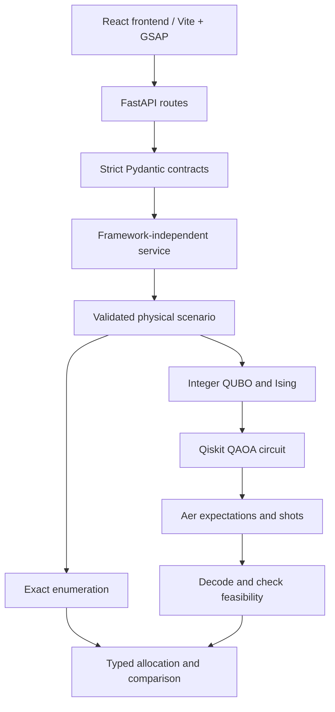

# Architecture and decisions

`backend/main.py` defines the five HTTP endpoints, structured errors, OpenAPI, CORS and per-process job admission. `backend/schemas.py` owns schema 1.0 requests/responses; cross-field validation delegates to the existing physical model. `backend/service.py` has no HTTP-framework imports: it calls the existing solvers, independently rechecks returned allocations, maps failures without hidden fallback and preserves actual measured metadata. `backend/settings.py` validates the explicit CORS allowlist.

The final frontend is React + TypeScript + Vite in frontend/ (implemented with GSAP and responsive CSS). Streamlit is outside this architecture: app.py and .streamlit/config.toml remain optional historical code, requirements-demo.txt is opt-in, and historical UI tests/startup code reside in legacy_demo/. Required tests/ discovery, CI and release gates exclude them. Neither backend/ nor src/ imports Streamlit; the backend environment report also omits it. CI creates a fresh backend-only venv and verifies absence of the optional package.

`models.py` owns inputs/physical constraints. `classical_solver.py` enumerates independently of quantum mapping. `optimization.py` handles rational normalization, bounded auxiliary bits, penalty expansion and basis energies. `quantum_solver.py` builds the cost/mixer circuit, optimizes angles, measures, and evaluates all sampled candidates. `evaluation.py` preserves the legacy comparison path and records installed package versions. Existing `app.py` remains unchanged as a legacy demo. `scripts/benchmark.py` persists the existing three reproducible scenarios. The separate React client consumes these contracts through the Vite proxy, with editable scenarios, real solver results, loading states and explicit errors.

## Significant choices

| What / why | How | Alternatives / tradeoffs | Validation |
|---|---|---|---|
| Fixed-duration selection makes the five-hour MVP auditable | Two resource bounds and mandatory bits | A time-slot MILP models flexibility more accurately, with more variables | Independent enumeration and boundary tests |
| Explicit circuit avoids version-sensitive optimizer wrappers | H, RZ, RZZ, RX; Aer; SciPy COBYLA | Built-in qaoa_ansatz is convenient; manual gates expose signs/scaling | Basis energies and conditional circuit phase/measurement tests |
| Exact decimal normalization prevents hidden discretization | Fraction, LCM, GCD, integer floor capacity | Coarse energy buckets would use fewer qubits but change feasibility | Decimal boundary and QUBO checks |
| Separate physical and auxiliary feasibility aids interpretation | Evaluate appliance bits; also check full penalty | Requiring valid auxiliary bits can discard safe measured decisions | Two measured probabilities and row-level flags |
| Separate backend from future React | Strict Pydantic -> framework-independent service -> existing engine | Embedding HTTP models in mathematics would couple future clients to solver internals | Executed service/schema checks; real FastAPI tests conditional on installation |
| Preserve historical Streamlit work separately | Existing app unchanged; optional requirements-demo.txt and legacy_demo/ checks | Keeping it in backend requirements/tests would impose an unwanted frontend dependency | Historical AppTest code preserved; not run by required backend validation |
| Explicit local CORS and compute limits | Two Vite origins, no credentials, one heavy job per process, API limits | This is not a production authentication/job-isolation system | Settings checks run; CORS/busy HTTP tests await FastAPI |
| Explicit blocked state preserves scientific honesty | Import failures/resource limits show classical result labeled | A fabricated quantum fallback is unacceptable | Missing-dependency benchmark records and release gate |

No private repository or external account is needed to run locally. A configured authorized GitHub remote is required for the separate submission/push milestone.

## Route semantics and validation boundaries

Classical infeasibility is a successful domain response with no allocation. Direct quantum optimization returns 413 for excessive encoding, 503 for missing/failed quantum execution. Comparison returns an explicit partial 200 response preserving the exact baseline; unknown gaps remain null. Allocation feasibility and physical resource usage are re-evaluated even if an upstream candidate includes cached values. Mandatory constraints are never relaxed.

The API permits 16 appliances while the independent core retains its prior 20-appliance cap. Quantum request bounds cannot exceed 14 qubits, 4 layers, 8,192 shots, 200 evaluations per restart and 3 restarts. Synchronous handlers run in FastAPI's threadpool, so CPU-bound solvers are not run directly in async event-loop handlers. A semaphore admits one heavy request per server process; it does not provide multi-process/global quotas or cancellation. Do not expose the unauthenticated prototype outside localhost without a deployment design.

Actual execution is now verified: all 72 backend tests passed with zero skips, including Qiskit/Aer and FastAPI requests. A separate Uvicorn process passed all 12 real HTTP cases, and actual QAOA benchmark data and reproducibility records were saved. The strict local release check passed. These local outcomes are distinct from publication and CI status.

## Runtime evidence and continuous integration

The real HTTP checker launches Uvicorn on an available localhost port and exercises all required routes and negative/CORS cases, including actual small QAOA requests. `scripts/evidence.py` independently reconstructs saved benchmark allocations, checks measured count totals/feasibility/best selection/gaps and requires the three distinct scenarios. `scripts/provenance.py` hashes runtime Python sources and requirements (normalizing checkout newline conventions), so stale evidence is rejected after code/test changes. Documentation edits alone do not invalidate runtime evidence.

The strict release gate executes tests once, writes their actual pass/skip/error evidence, and checks HTTP/benchmark records. `.github/workflows/backend-ci.yml` runs this sequence on push/PR/manual dispatch using official GitHub actions, Python 3.13 and read-only repository permissions. It fails if either real runtime command fails, even if an older record exists. The workflow retains result artifacts but does not commit/push, change account permissions, or imply a successful run merely by existing.
